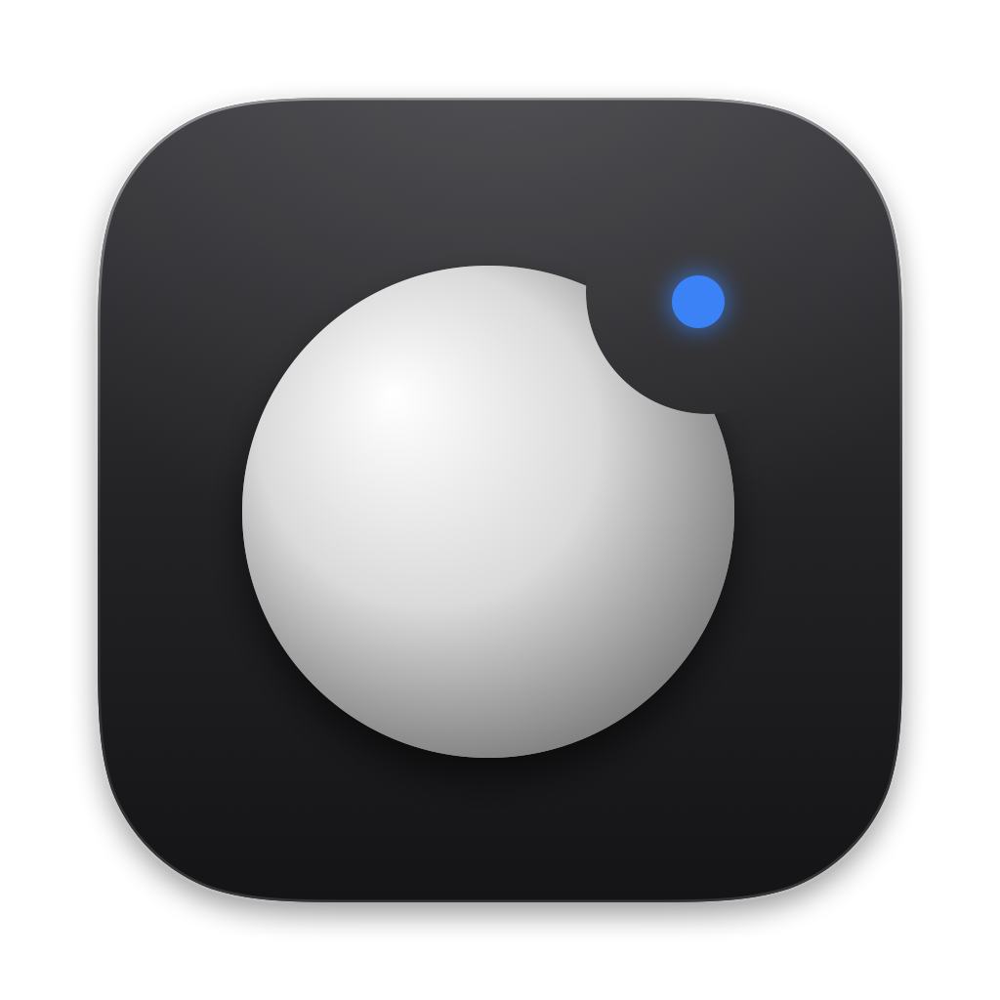
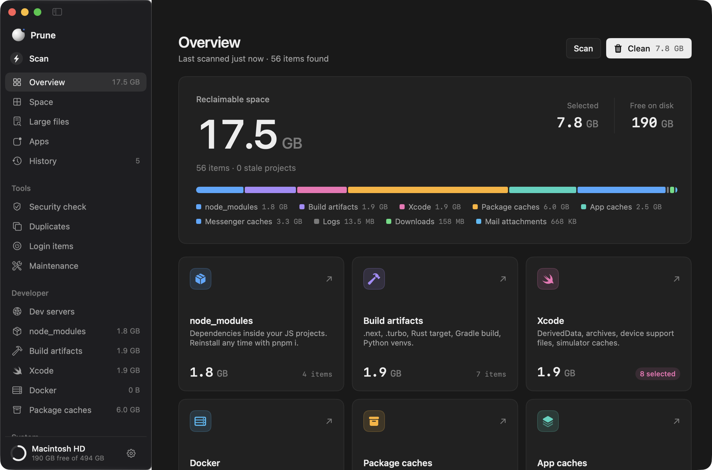
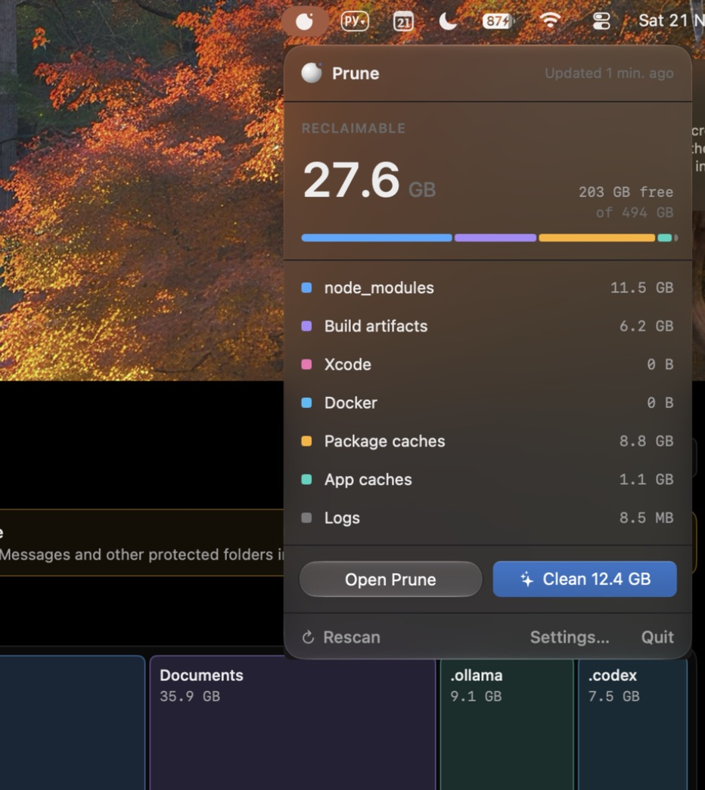

<p align="center"></p>

<h1 align="center">Prune</h1>

<p align="center"><strong>Free, open-source macOS disk cleaner, storage treemap analyzer, duplicate &amp; similar photo finder, app uninstaller, and developer cleanup tool.</strong><br>See what is taking space on your Mac and clean it safely — files move to the Trash first, so you can put them back.</p>

<p align="center">
  <a href="https://prune.gh0styx.com">Website</a> ·
  <a href="https://prune.gh0styx.com/guides">Guides &amp; Documentation</a> ·
  <a href="https://github.com/gh0styx/prune/releases/latest">Download DMG</a>
</p>

<p align="center"></p>

## Why Prune

Prune is a lightweight native SwiftUI app (and companion `prune` CLI) for **macOS 15+** on **Apple Silicon and Intel** Macs (one universal app). Signed with a Developer ID and notarized by Apple. No account, no subscription, no telemetry (the only network request is the update check) — an honest, MIT-licensed open-source alternative to CleanMyMac, DaisyDisk, and AppCleaner.

- **Localized in English, Russian, and Ukrainian** (follows your Mac's language or switches inside Settings).
- **Safe by default:** files move to the macOS Trash with full **History** logging and Finder-based restore. Prune only touches your home folder, whole apps in `/Applications` and files on external disks; everything else is refused.

## Space (Interactive Disk Map)

A treemap of your whole home folder and `/Applications`. Click any block to go deeper, use the breadcrumbs or `⌘[` to come back, and right-click to reveal in Finder or move to the Trash.

<p align="center"></p>

## What it finds

| Category | What |
|---|---|
| `node_modules` | Every `node_modules` under your project folders, with lockfile detection (`pnpm`, `bun`, `yarn`, `npm`) |
| Build artifacts | `.next`, `.nuxt`, `.svelte-kit`, `.turbo`, `.parcel-cache`, `.angular`, `.docusaurus`, Rust `target/`, Gradle `build/` &amp; `.gradle`, Python `.venv` / `venv` |
| Xcode | `DerivedData`, `Archives` (never pre-selected), `iOS`/`watchOS`/`tvOS`/`visionOS` `DeviceSupport`, unavailable simulators, simulator runtimes, `CoreSimulator/Caches` |
| Docker | Unused images, build cache, stopped containers, unused anonymous volumes (Docker Desktop &amp; OrbStack; named volumes are never pruned) |
| Large files | Files over 100 MB (configurable) anywhere in your home folder — never pre-selected as junk |
| Package caches | npm, pnpm store &amp; cache, Yarn, Bun, pip, uv, Homebrew, Cargo, Gradle, CocoaPods, Go build, Playwright browsers, Puppeteer browsers, Electron, node-gyp, Deno |
| App caches | `~/Library/Caches` (Apple's own caches are skipped) |
| Logs | `~/Library/Logs` |
| Downloads | Installers (`.dmg`, `.pkg`, `.mpkg`, `.zip`, `.xip`, `.iso`, `.app`) of any age and files untouched for 90+ days |
| Messenger caches | Media and animation caches of Telegram from the Mac App Store (`Group Containers`); they download again, chats are not touched |
| Mail attachments | Attachments Apple Mail saved when opened (re-downloaded automatically if needed) |
| iOS backups | Local iPhone and iPad backups in `MobileSync/Backup` |
| System Data | Time Machine local snapshots (`tmutil`), Group Container &amp; Container caches, leftover uninstalled-app containers, idle Chromium `.code_sign_clone` temp folders, and report-only visibility for VM disks and system logs |

**Stale projects.** Prune reads each project's last Git commit. Projects untouched for 90 days (adjustable in Settings: 30 days to 1 year) are marked stale and their dependencies are pre-selected.

**Safe by default.** Files go to the Trash, so you can put them back. Two exceptions are clearly marked in the app: Docker items are removed with the `docker` CLI and Time Machine snapshots with `tmutil`, and those can't be restored.

Developer categories can be hidden in Settings or during the welcome tour ("Clean my Mac" vs "I write code").

## Tools

- **Large files.** Files over 100 MB (configurable) in your home folder. Not junk by default, so look before you remove.
- **Duplicates.** Identical files and visually similar photos. Keeps at least one copy in every group and moves the rest to the Trash.
- **Security check.** Audits `LaunchAgents`, `LaunchDaemons`, Safari/Chromium browser extensions, and known adware name patterns alongside Gatekeeper, SIP, XProtect, FileVault, and Firewall status. Not an antivirus.
- **Login items.** `LaunchAgents` and `LaunchDaemons` that start on their own when you log in.
- **Maintenance.** Flush DNS cache, reindex Spotlight, run periodic scripts, rebuild Launch Services, reset Quick Look cache, clear font caches, and purge inactive memory. Admin tasks use the standard system password dialog.
- **Dev servers.** Local servers and processes listening on ports. Stop the ones you forgot.
- **Apps.** Uninstall apps together with the leftovers they scatter across 9 `~/Library` directories (`Application Support`, `Caches`, `Containers`, `Preferences`, `Saved Application State`, `HTTPStorages`, `WebKit`, `Logs`, `Application Scripts`).
- **History.** Earlier cleanups. Items still in the Trash can be freed or restored via Finder.

## Terminal CLI (`prune`)

Prune also ships a companion Swift CLI in [`cli/`](cli/) using the same `PruneCore` scanners and Trash rules (dry run by default unless `--yes` is passed):

```bash
brew install gh0styx/tap/prune  # install the CLI with Homebrew
prune scan                      # show reclaimable space across all categories
prune clean caches logs --yes   # move app caches and logs to the Trash
prune purge --stale --yes       # move stale node_modules and build artifacts to Trash
prune analyze ~/Downloads       # largest folders and files (or --path DIR)
prune duplicates --photos       # find visually similar photos
prune uninstall Figma --yes     # uninstall app + Library leftovers
prune history --json            # JSON cleanup log
```

## Guides & Documentation

Read detailed guides for everyday Mac users and developers on [prune.gh0styx.com/guides](https://prune.gh0styx.com/guides):

- [How to Find and Delete Duplicate Files and Similar Photos on Mac](https://prune.gh0styx.com/guides/find-and-delete-duplicate-photos-and-files-mac)
- [How to Completely Uninstall Apps on Mac (With Hidden Library Leftovers)](https://prune.gh0styx.com/guides/uninstall-mac-apps-and-library-leftovers)
- [How to Clean Old iPhone Backups, Mail Attachments & Telegram Cache on Mac](https://prune.gh0styx.com/guides/delete-old-iphone-backups-and-mail-attachments-mac)
- [How to Clean Mac Downloads, App Caches, Logs & Large Files Safely](https://prune.gh0styx.com/guides/clean-mac-downloads-caches-and-large-files)
- [How to Manage Mac Login Items and Run macOS Maintenance Tasks](https://prune.gh0styx.com/guides/speed-up-mac-login-items-and-maintenance)
- [How to Check Your Mac for Adware, Browser Extensions & Protection Status](https://prune.gh0styx.com/guides/check-mac-for-adware-extensions-and-security)
- [What Is Safe to Delete on a Mac (and What to Never Touch)](https://prune.gh0styx.com/guides/what-is-safe-to-delete-on-mac)
- [Your Mac Disk Is Almost Full: A Calm 15-Minute Plan](https://prune.gh0styx.com/guides/mac-disk-almost-full-what-to-do)
- [Free CleanMyMac Alternative for Mac: How Prune Compares](https://prune.gh0styx.com/guides/free-cleanmymac-alternative-mac)
- [How to Clear Telegram Cache on Mac Without Losing Chats](https://prune.gh0styx.com/guides/clear-telegram-cache-mac)
- [Monitor Mac Disk Space: Menu Bar, Reminders and External Drives](https://prune.gh0styx.com/guides/monitor-mac-disk-space-menu-bar-external-drives)
- [How to Clean `node_modules` and Build Artifacts on Mac Safely](https://prune.gh0styx.com/guides/clean-node-modules-and-build-artifacts-mac)
- [How to Clear Xcode DerivedData, Archives, and iOS Simulators on Mac](https://prune.gh0styx.com/guides/clear-xcode-deriveddata-and-simulators)
- [How to Reduce “System Data” on macOS Without Guesswork](https://prune.gh0styx.com/guides/reduce-system-data-on-macos)
- [How to Free Disk Space on Mac: Disk Map, Large Files, Duplicates & Apps](https://prune.gh0styx.com/guides/free-disk-space-mac-complete-guide)
- [How to Clean Docker Images, Build Cache, and Package Caches on Mac](https://prune.gh0styx.com/guides/clean-docker-and-package-caches-mac)
- [Prune CLI, Mac Security Check, Login Items & Maintenance Tools](https://prune.gh0styx.com/guides/prune-cli-security-check-and-maintenance)

## Menu bar



- **Live rings** for CPU, memory (counted the way Activity Monitor does) and disk.
- **Quick tools:** Keep awake (with a 15 min – 5 h timer; a cup shows next to the icon while it is on), keyboard cleaning (locks the keys while you wipe them, unlocks with Done or after 90 s), free inactive memory, empty the Trash (asks first) and eject all external disks.
- **Settings → Menu bar** has a switch for every ring, card and tool, with a live preview of the panel.

## Install

1. Download `Prune-x.y.z.dmg` from [Releases](../../releases).
2. Open it and drag **Prune** into **Applications**.
3. Open Prune. Releases are signed with a Developer ID and notarized by Apple, so it opens without warnings.

Prune keeps itself up to date (Sparkle): it checks for a new version once a day, or use **Check for Updates…**.

Scans need Full Disk Access, so results are never silently incomplete. Prune opens the right pane in System Settings and shows a card you drag into the list. Keyboard cleaning needs Accessibility access, set up the same way.


## Build

Requires macOS 15+ and Xcode 16+.

```bash
./scripts/build-app.sh
open build/Prune.app
```

Installer:

```bash
./scripts/make-dmg.sh
```

It signs with a Developer ID or Apple Development identity if one is in your keychain (ad-hoc otherwise). With a Developer ID, set `NOTARY_PROFILE` to a `notarytool` keychain profile to notarize and staple the DMG.

Self-test (read-only, runs every scanner and the safety rules):

```bash
swift run Prune --selftest
```

For development: `swift run`.

The app icon is drawn in code (`Sources/Prune/IconArt.swift`). The build script renders it with `Prune --render-icon <dir>`.

## Roadmap

- Cleanup rules: set them once, and Prune suggests the same cleanup every month
- Disk history: compare snapshots over time to see what grew
- Shortcuts: run a scan or cleanup from Spotlight or Shortcuts
- Homebrew cask for the app (the CLI is already on Homebrew)
- More languages

## License

MIT
