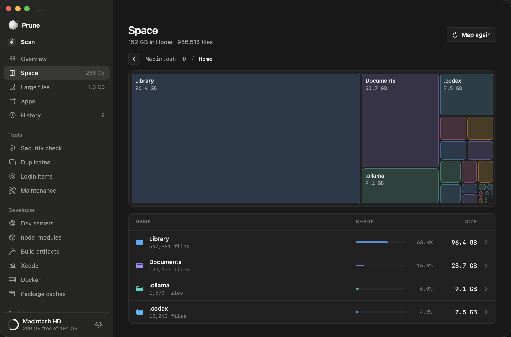
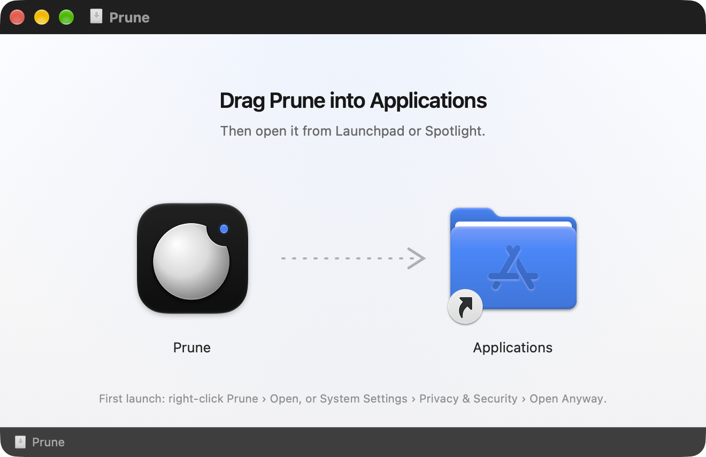

<p align="center"></p>

<h1 align="center">Prune</h1>

<p align="center">See what's taking space on your Mac and clean it safely. A full disk map, large files, caches and logs, with a developer mode for <code>node_modules</code>, build output, Xcode, Docker and package caches.</p>

<p align="center"></p>

## Space

A treemap of your whole home folder and Applications. Click any block to go deeper, use the breadcrumbs or ⌘[ to come back. Right-click to reveal in Finder or move to the Trash.

<p align="center"></p>

## What it finds

| Category | What |
|---|---|
| node_modules | Every `node_modules` under your project folders |
| Build artifacts | `.next`, `.nuxt`, `.svelte-kit`, `.turbo`, `.parcel-cache`, Rust `target/`, Gradle `build/`, Python venvs |
| Xcode | DerivedData, Archives, iOS/watchOS DeviceSupport, simulator caches |
| Docker | Unused images, build cache, stopped containers, unused volumes (via `docker … prune`) |
| Large files | Files over 100 MB (configurable) anywhere in your home folder |
| Package caches | npm, pnpm, Yarn, Bun, pip, uv, Homebrew, Cargo, Gradle, CocoaPods, Go, Playwright |
| App caches | `~/Library/Caches` (Apple's own caches are skipped) |
| Logs | `~/Library/Logs` |
| Downloads | Installers you already used and files untouched for 90+ days |
| Messenger caches | Photos, videos and files kept by messengers (they download again when you open a chat) |
| Mail attachments | Attachments Mail saved when you opened them |
| iOS backups | Local backups of iPhone and iPad (check you have a newer one first) |
| System data | Time Machine snapshots and app caches in Group Containers |

**Stale projects.** Prune reads each project's last git commit. Projects untouched for 90+ days are marked stale and their dependencies are pre-selected.

**Safe by default.** Nothing is deleted. Everything goes to the Trash, so you can put it back. Paths outside your home folder are refused.

Developer categories can be hidden in Settings or during the welcome tour ("Clean my Mac" vs "I write code").

## Tools

- **Large files.** Files over 100 MB (configurable) in your home folder. Not junk by default, so look before you remove.
- **Duplicates.** Identical files and similar photos. Keep one, move the rest to the Trash.
- **Security check.** Startup items, browser extensions and known adware, plus the Mac's built-in protections. Not an antivirus.
- **Login items.** Apps and helpers that start on their own when you log in.
- **Maintenance.** Small fixes that keep macOS running smoothly. Some ask for your password.
- **Dev servers.** Local servers and processes listening on ports. Stop the ones you forgot.
- **Apps.** Remove apps together with the files they leave in your Library.
- **History.** Earlier cleanups. Items still in the Trash can be freed or put back.

## Menu bar


## Install

1. Download `Prune-x.y.z.dmg` from [Releases](../../releases).
2. Open it and drag **Prune** into **Applications**.
3. First launch: Prune isn't notarized by Apple yet, so macOS asks for confirmation once.
   Right-click Prune in Applications and choose **Open**, or go to **System Settings › Privacy & Security** and click **Open Anyway**.
   From the terminal you can also run:

   ```bash
   xattr -dr com.apple.quarantine /Applications/Prune.app
   ```

Prune asks for access to Documents, Desktop and Downloads on the first scan. Full Disk Access is optional and makes the disk map complete.



## Build

Requires macOS 15+ and Xcode 16+.

```bash
./scripts/build-app.sh
open build/Prune.app
```

Installer:

```bash
./scripts/make-dmg.sh
```

It signs with a Developer ID or Apple Development identity if one is in your keychain (ad-hoc otherwise). With a Developer ID, set `NOTARY_PROFILE` to a `notarytool` keychain profile to notarize and staple the DMG.

Self-test (read-only, runs every scanner and the safety rules):

```bash
swift run Prune --selftest
```

For development: `swift run`.

The app icon is drawn in code (`Sources/Prune/IconArt.swift`). The build script renders it with `Prune --render-icon <dir>`.

## Roadmap

- Scheduled scans with a "you have 20 GB to clean" notification
- Notarized release and Homebrew cask

## License

MIT
